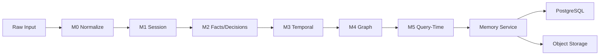

# SwarmVault WebApp — Enterprise Architecture Forensics Prompt

## VERSION

Version: 2.0 (improved from v1.0 baseline)
Date: 2026-09-10
Status: DRAFT — review before execution

---

## 0. PREAMBLE — CODEBASE REALITY ANCHOR (MANDATORY)

Before making ANY architectural statement, verify it against the actual source tree.
If a statement contradicts any item below, STOP and record the contradiction as a finding.

### Verified Codebase Characteristics

| Aspect | Verified State | Evidence |
|--------|---------------|----------|
| Rate limiting | In-memory sliding window per-IP and per-user | `app/middleware/rate_limit.py` — class `RateLimitMiddleware`, comment "Sprint 6" |
| Rate limit bypass | `_disabled_for_testing` flag + `X-E2E` header | `rate_limit.py` — flag check at `__init__`, header check in `dispatch` |
| Rate limit production readiness | NOT production-ready — comment says "replace with Redis" | `rate_limit.py` inline comment |
| Memory cache | In-process Python dict, NOT Redis | `app/services/memory.py` — `self._cache: dict[str, MemoryRecord] = {}` |
| M5 retrieval | Query-time only, NO pre-built index | `app/services/pipeline.py` — M5 stage has no indexing step |
| M5 implementation | M5 stage label exists but no `m5_retrieval.py` service | No file `app/services/m5_retrieval.py` in source tree |
| Contradiction detection | None beyond supersession (same subject+predicate, different object) | `pipeline.py:113-135` — `_find_current_fact` checks only subject+predicate |
| Content deduplication | None at ingestion or pipeline level | No hash/dedup logic found in connectors or pipeline |
| Database migrations | No `alembic/`, `migrations/`, or `db/migrate/` directory | Glob confirmed — only `app/models.py` exists for schema |
| Policy engine | Hardcoded RBAC via `generate_rbac_policies()` | `app/services/policy/evaluator.py` |
| Frontend state | React hooks + Context ONLY (no external state library) | `frontend/src/` — no Redux, Zustand, Jotai in deps |
| SSE usage | Chat streaming ONLY | `app/api/chat.py` + `frontend/src/hooks/useSSE.tsx` |
| Object storage | S3 + MinIO backends, configurable default | `app/services/object_storage.py`, `app/services/object_storage_minio.py` |
| Frontend API client | Direct fetch in feature hooks, no central typed client | `frontend/src/features/*/use*.ts` — each hook has its own fetch calls |
| LLM provider | Anthropic Claude API | `app/services/llm.py` — imports `anthropic` |
| Object storage MIME validation | No MIME type validation in upload | `app/api/ingest.py` — no Content-Type check on upload |
| Password hashing | bcrypt via passlib | `app/core/security.py` — `pwd_context = CryptContext(schemes=["bcrypt"])` |
| JWT algorithm | HS256 | `app/core/security.py` — `ALGORITHM = "HS256"` |
| JWT expiry | 30 minutes (ACCESS_TOKEN_EXPIRE_MINUTES) | `app/core/config.py` or equivalent |
| Session model | Has `extra_metadata` JSON column | `app/models.py` — `Session.extra_metadata` |
| Source model | Has `config` JSON column, `stage` enum, `progress` int | `app/models.py` — `Source` model |
| Fact model | Has `subject`, `predicate`, `object`, `confidence`, `authority`, `temporal_status` | `app/models.py` — `Fact` model |
| Decision model | Has `content`, `context`, `confidence`, `authority`, `temporal_status` | `app/models.py` — `Decision` model |
| Memory model | Has `memory_type`, `content`, `confidence`, `authority`, `extra_metadata`, `deleted_at` | `app/models.py` — `Memory` model |
| GraphNode model | Has `label`, `properties` JSON | `app/models.py` — `GraphNode` model |
| GraphEdge model | Has `source_id`, `target_id`, `relationship_type`, `properties` JSON | `app/models.py` — `GraphEdge` model |
| AuditLog model | Has `event_type`, `principal_id`, `resource_type`, `result_status`, `duration_ms` | `app/models.py` — `AuditLog` model |
| Frontend routes | /login, /register, /dashboard, /projects, /projects/[id]/* | `frontend/src/app/` — App Router |
| Frontend project sub-routes | /sessions, /chat, /memory, /facts, /decisions, /timeline, /search, /graph, /provenance, /ingest, /settings | `frontend/src/app/projects/[id]/` |
| Frontend settings sub-routes | /, /profile, /api-keys, /storage | `frontend/src/app/settings/` |
| No API key model | No API key database model found | `app/models.py` — no ApiKey model |
| API key endpoints | Not implemented in backend routers | No api_keys router in `app/api/` |
| No Dockerfile | No Dockerfile or docker-compose found in repo root | Glob confirmed |

---

## 1. MISSION AND SCOPE

You are the **Principal Enterprise Architect** performing a **repository-first architectural forensic analysis** of the **COMPLETE SwarmVault WebApp**.

Your mission is **NOT** to modify, refactor, or redesign the product.

Your mission IS to produce an authoritative architecture documentation package that:

1. Describes what the system DOES (not what it should do)
2. Traces actual execution paths through the code
3. Identifies every architectural gap, inconsistency, and risk
4. Assesses readiness for persistent memory and future memory intelligence
5. Provides traceability from requirements through to persistence

### 1.1 Out of Scope (Strictly Forbidden)

- Modifying any production code
- Renaming modules, functions, or variables
- Changing API contracts
- Altering database schema
- Implementing fixes
- Creating feature code
- "Improving" anything in the product

### 1.2 In Scope (Authorized Output)

- Architecture documentation files (Markdown)
- Evidence tables with file:line citations
- Traceability matrices
- Mermaid diagrams (in Markdown)
- Gap analysis documents
- Risk registers
- Classification tables
- Generated inventories

---

## 2. ABSOLUTE RULES (Non-Negotiable)

### RULE 1 — REPOSITORY IS THE PRIMARY SOURCE OF TRUTH

For every architectural statement, identify at least ONE of:
- Exact file path (e.g., `app/services/pipeline.py:32`)
- Module name
- Class/function name
- Route path + HTTP method
- SQLAlchemy model + column name
- Pydantic schema
- Database migration file (if any)
- Configuration key
- Test file + test function name
- Runtime dependency from `requirements.txt`
- Actual execution path (call chain with line numbers)

> **Documentation may support understanding but must not override executable implementation without explicitly identifying the discrepancy as a finding.**

### RULE 2 — DO NOT MODIFY PRODUCT CODE

Allowed changes: `docs/**/*.md`, `docs/**/*.mermaid`, architecture artifacts only.

### RULE 3 — DO NOT INVENT FEATURES

Every capability must be classified as exactly one of:

| Classification | Definition |
|---------------|-----------|
| `IMPLEMENTED` | Verified in source code with a traceable execution path |
| `PARTIALLY IMPLEMENTED` | Code exists but incomplete or conditional |
| `IMPLEMENTED BUT UNVERIFIED` | Code exists, no test or runtime verification found |
| `DOCUMENTED ONLY` | Mentioned in docs but no source implementation found |
| `PLANNED` | Mentioned in roadmap/specs, no code |
| `MISSING` | Expected but absent from codebase |
| `BLOCKED` | Code exists but gated by unresolved dependency |
| `DEPRECATED` | Code exists but marked for removal |
| `UNKNOWN` | Cannot determine status |

### RULE 4 — TRACE DATA, NOT JUST COMPONENTS

For every data element, trace:

```
WHERE DOES IT ENTER?
    ↓ HOW IS IT NORMALIZED?
    ↓ HOW IS IT VALIDATED?
    ↓ HOW IS IT TRANSFORMED AT EACH STAGE?
    ↓ HOW IS IT REPRESENTED AT REST?
    ↓ HOW IS IT SCORED?
    ↓ HOW IS IT STORED?
    ↓ HOW IS IT RETRIEVED?
    ↓ HOW IS IT PRESENTED?
    ↓ CAN IT BECOME PERSISTENT MEMORY?
    ↓ CAN A FUTURE MEMORY INTELLIGENCE LAYER TRUST IT?
```

Every transition must document:
- **Input contract** (schema, validation, guardrails)
- **Output contract** (schema, serialization)
- **Failure mode** (what happens on bad input)
- **Persistence effect** (what is written, what is not)
- **Provenance effect** (what metadata is attached)
- **Memory quality effect** (confidence, authority, temporal status)

---

## 3. REPOSITORY IDENTITY (Phase 0)

### 3.1 Establish Baseline

Run these commands and record results:

```bash
cd C:\Users\Administrator\Documents\SwarmVaultwebapp
git rev-parse --show-toplevel
git branch --show-current
git rev-parse HEAD
git status --short
git log --oneline -10
```

### 3.2 Repository Structure

```
C:\Users\Administrator\Documents\SwarmVaultwebapp\
├── app/                          # BACKEND ROOT (FastAPI)
│   ├── main.py                   # Application entry point
│   ├── database.py               # DB engine & session factory
│   ├── dependencies.py           # DI providers
│   ├── models.py                 # SQLAlchemy ORM models (all tables)
│   ├── schemas/                  # Pydantic schemas
│   ├── api/                      # FastAPI routers
│   │   ├── auth.py
│   │   ├── chat.py
│   │   ├── ingest.py
│   │   ├── memory.py
│   │   ├── facts.py
│   │   ├── decisions.py
│   │   ├── graph.py
│   │   ├── provenance.py
│   │   ├── search.py
│   │   ├── sessions.py
│   │   └── ...
│   ├── services/                 # Business logic layer
│   │   ├── pipeline.py           # M0→M5 orchestration
│   │   ├── connectors.py         # M0 normalization
│   │   ├── m1_session.py         # M1 session understanding
│   │   ├── m2_facts.py           # M2 fact/decision extraction
│   │   ├── m3_temporal.py        # M3 temporal supersession
│   │   ├── m4_graph.py           # M4 graph construction
│   │   ├── memory.py             # Memory service (Sprint 8)
│   │   ├── chat_orchestrator.py  # Chat with LLM
│   │   ├── llm.py                # LLM provider abstraction
│   │   ├── object_storage.py     # S3 object storage
│   │   ├── object_storage_minio.py # MinIO object storage
│   │   ├── audit/                # Audit subsystem
│   │   └── policy/               # RBAC policy engine
│   ├── middleware/                # HTTP middleware
│   │   ├── rate_limit.py         # In-memory sliding window
│   │   ├── auth.py               # JWT extraction
│   │   ├── tenancy.py            # Workspace/project scope
│   │   └── rbac.py               # Policy enforcement
│   ├── core/                     # Core utilities
│   │   ├── security.py           # JWT, bcrypt
│   │   └── config.py             # Settings
│   └── tests/                    # Backend tests
├── frontend/                     # FRONTEND ROOT (Next.js 15)
│   ├── src/
│   │   ├── app/                  # App Router pages
│   │   │   ├── layout.tsx
│   │   │   ├── page.tsx
│   │   │   ├── auth/
│   │   │   │   ├── login/page.tsx
│   │   │   │   └── register/page.tsx
│   │   │   ├── dashboard/page.tsx
│   │   │   ├── projects/
│   │   │   │   ├── page.tsx
│   │   │   │   └── [id]/
│   │   │   │       ├── layout.tsx
│   │   │   │       ├── sessions/page.tsx
│   │   │   │       ├── chat/page.tsx
│   │   │   │       ├── memory/page.tsx
│   │   │   │       ├── facts/page.tsx
│   │   │   │       ├���─ decisions/page.tsx
│   │   │   │       ├── timeline/page.tsx
│   │   │   │       ├── search/page.tsx
│   │   │   │       ├── graph/page.tsx
│   │   │   │       ├── provenance/page.tsx
│   │   │   │       ├── ingest/page.tsx
│   │   │   │       └── settings/page.tsx
│   │   │   └── settings/
│   │   │       ├── page.tsx
│   │   │       ├── profile/page.tsx
│   │   │       ├── api-keys/page.tsx
│   │   │       └── storage/page.tsx
│   │   ├── components/
│   │   │   ├── ui/               # Reusable UI primitives
│   │   │   │   ├── Card.tsx
│   │   │   │   ├── Button.tsx
│   │   │   │   ├── Badge.tsx
│   │   │   │   ├── Toast.tsx
│   │   │   │   ├── Tabs.tsx
│   │   │   │   ├── StatCard.tsx
│   │   │   │   ├── Skeleton.tsx
│   │   │   │   ├── LoadingSpinner.tsx
│   │   │   │   ├── ErrorAlert.tsx
│   │   │   │   ├── EmptyState.tsx
│   │   │   │   ├── ConfirmDialog.tsx
│   │   │   │   ├── Pagination.tsx
│   │   │   │   ├── FileInput.tsx
│   │   │   │   ├── Tooltip.tsx
│   │   │   │   ├── Collapsible.tsx
│   │   │   │   ├── Progress.tsx
│   │   │   │   └── useClipboard.ts
│   │   │   └── Sidebar.tsx
│   │   ├── features/             # Feature-level hooks
│   │   │   ├── memory/useMemory.ts
│   │   │   ├── chat/useChat.ts
│   │   │   ├── ingest/useIngest.ts
│   │   │   ├── search/useSearch.ts
│   │   │   ├── graph/useGraph.ts
│   │   │   ├── projects/useProjects.ts
│   │   │   └── apiKeys/useApiKeys.ts
│   │   ├── hooks/
│   │   │   ├── useSSE.tsx        # SSE streaming hook
│   │   │   ├── useTheme.tsx      # Theme toggle
│   │   │   ├── AppShell.tsx      # Layout wrapper
│   │   │   └── AuthRedirect.tsx  # Auth guard
│   │   ├── lib/
│   │   │   ├── api.ts            # API base config
│   │   │   └── errors.ts         # Error types
│   │   └── types/
│   │       └── api.ts            # TypeScript types
│   ├── package.json
│   ├── tsconfig.json
│   ├── tailwind.config.js
│   └── next.config.js
├── docs/                         # Documentation output target
├── requirements.txt
└── [config files]
```

### 3.3 Dependency Inventory

**Backend** — parse `requirements.txt` for exact versions of:
- fastapi, uvicorn, sqlalchemy, asyncpg, python-jose, passlib, bcrypt, anthropic, boto3, pydantic, and all others

**Frontend** — parse `frontend/package.json` for:
- next, react, react-dom, lucide-react (runtime)
- @playwright/test, @types/*, tailwindcss, postcss, autoprefixer (dev)

### 3.4 Baseline Document

Create `docs/ARCHITECTURE_FORENSICS_BASELINE.md` with:
- Repository root path
- Git branch
- HEAD SHA (full 40-char)
- Working tree state (clean/modified/untracked files)
- Analysis timestamp
- Complete directory tree (top 3 levels)
- Backend/frontend/test/deployment paths
- Key dependency versions
- Codebase reality anchor table (Section 2 above)

**Do NOT continue if repository identity cannot be established.**

---

## 4. PARALLEL AGENT PROGRAM

Launch exactly **7 specialist agents in parallel**, each writing to its own document.
Each agent reads actual source, traces execution paths, classifies findings, and never modifies product code.

---

## AGENT 1 — BACKEND RUNTIME ARCHITECTURE

**Output:** `docs/SWARMVAULT_BACKEND_ARCHITECTURE.md`

### A1.1 Application Startup & Construction

Read `app/main.py`. Document:
- FastAPI app instantiation: title, version, docs URL, debug mode
- Middleware registration: **ORDER MATTERS** — list in registration order with exact line numbers
- Router inclusion: which routers, in what order, with what prefixes
- CORS configuration: allowed origins, methods, headers, credentials
- Exception handlers: which exceptions, which handlers
- Startup events (if any)
- Shutdown events (if any)

Read `app/database.py`. Document:
- Engine creation: driver (`asyncpg`?), URL composition
- Session factory: `async_sessionmaker` configuration
- `get_db` dependency: how sessions are provided to routes
- Connection pool settings
- Any engine events

### A1.2 Middleware Stack (Ordered Execution)

Read each middleware file in `app/middleware/`. For EACH middleware:

| Property | Detail |
|----------|--------|
| Class name | |
| Base class | |
| Entry point | `dispatch()` method signature |
| What it inspects | Headers, path, body, etc. |
| What it modifies | Request state, headers, etc. |
| What it rejects | Status codes, conditions |
| Pass-through conditions | |
| Bypass conditions | Test mode, env checks, specific headers |

**CRITICAL — RateLimitMiddleware (`app/middleware/rate_limit.py`):**
- Document the sliding window algorithm (fixed window? sliding window?)
- Document `_disabled_for_testing` — when is it True?
- Document `X-E2E` header bypass — exact condition
- Document per-IP key format
- Document per-user key format (uses raw Authorization header — flag this)
- **FINDING: Flag that in-memory rate limiter is non-functional in multi-worker deployments**
- **FINDING: Flag that Authorization header value is used as a key component (potential information leak in logs/memory dumps)**

### A1.3 Router Inventory

Read every file in `app/api/`. For each file:

```
FILE: app/api/<name>.py
ROUTER PREFIX: <prefix>
DEPENDENCIES: <list of DI providers>
ENDPOINTS:
  <METHOD> <PATH> → <handler_function>
    - Request schema: <Pydantic model or None>
    - Response schema: <Pydantic model or None>
    - Auth required: <yes/no>
    - Dependencies: <list>
```

### A1.4 Service Layer Architecture

Read every file in `app/services/`. For EACH service:

```
FILE: app/services/<name>.py
CLASS: <class_name>
PURPOSE: <one line>
CONSTRUCTOR DEPS: <list>
PUBLIC METHODS:
  - <method_name>(<signature>) → <return_type>
    PURPOSE: <one line>
    DB INTERACTION: <yes/no, pattern>
    EXTERNAL CALLS: <yes/no, what>
    ERROR HANDLING: <strategy>
```

### A1.5 Model Inventory

Read `app/models.py`. For EACH model:

```
TABLE: <table_name>
MODEL: <class_name>
COLUMNS:
  - <name>: <type>, <constraints>, <default>
    TENANT ISOLATION: <yes/no, which column>
    SOFT DELETE: <yes/no, which column>
    TIMESTAMP: <yes/no, which columns>
    JSON/METADATA: <yes/no, which column>
    RELATIONSHIPS: <list of foreign keys + back-populates>
    INDEXES: <list>
```

### A1.6 Dependency Injection

Read `app/dependencies.py` (or wherever DI providers are defined). Document:
- `get_db` → how AsyncSession is created and closed
- `get_current_user` → how user is extracted from JWT
- `get_tenant_context` → how workspace/project context is resolved
- Policy engine provision → singleton? per-request?
- Audit service provision → singleton? per-request?

### A1.7 Authentication & Authorization

Read `app/core/security.py`, `app/api/auth.py`, `app/middleware/auth.py`, `app/middleware/rbac.py`, `app/services/policy/`.

Document:
- Registration: password hashing (bcrypt rounds?), JWT creation, user creation flow
- Login: password verification, access token creation, refresh mechanism
- Token refresh: does it exist? how?
- Logout: does it exist? token invalidation mechanism?
- JWT payload: exact claims (sub, exp, tenant_id, workspace_id?)
- Token expiry: exact values
- RBAC: policy source (hardcoded function? database?), evaluation flow, fail behavior

### A1.8 Tenancy & Workspace Isolation

Read `app/middleware/tenancy.py`. Document:
- How tenant_id is determined (JWT claim? header?)
- How workspace_id is resolved
- How project_id is resolved
- Isolation enforcement point (middleware vs service layer)
- Cross-tenant access prevention mechanism

### A1.9 Error Handling

Document:
- Custom exception classes (if any)
- HTTPException patterns
- Error response format
- Information leakage risk: are stack traces returned? SQL errors?

### A1.10 Observability

Document:
- Logging: configuration, format, levels
- Structured logging patterns
- Audit event emission (how, where, what events)
- Health check endpoints
- Metrics (if any)

### A1.11 Representative Request Traces

Trace these 3 requests with actual line numbers:

**TRACE-1: POST /api/v1/chat/** (authenticated chat)
```
1. RateLimitMiddleware.dispatch()          [rate_limit.py:<line>]
2.   → skip if disabled or X-E2E header
3.   → check per-IP key [rate_limit.py:<line>]
4.   → check per-user key [rate_limit.py:<line>]
5. AuthMiddleware.dispatch()               [middleware/auth.py:<line>]
6.   → extract Bearer token
7.   → decode JWT
8. TenancyMiddleware.dispatch()            [middleware/tenancy.py:<line>]
9.   → resolve workspace/project from JWT
10. RBACMiddleware.dispatch()              [middleware/rbac.py:<line>]
11.   → evaluate policy
12. chat router → handler                  [api/chat.py:<line>]
13.   → validate request (Pydantic)
14. chat_orchestrator service              [services/chat_orchestrator.py:<line>]
15.   → LLM call (Claude API)
16.   → Session persistence
17.   → Memory persistence
18. Response (JSON or SSE stream)
```

**TRACE-2: POST /api/v1/ingest/upload** (file ingestion)
```
1. RateLimitMiddleware
2. AuthMiddleware
3. TenancyMiddleware
4. RBACMiddleware
5. ingest router → handler
6.   → file validation (type? size?)
7.   → object storage (S3 or MinIO)
8. pipeline.run_pipeline()
9.   → M0: normalize
10.  → M1: session understanding
11.  → M2: fact/decision extraction
12.  → M3: temporal supersession
13.  → M4: graph persistence
14.  → M5: (no-op, query-time)
15. Source status → completed
16. Response
```

**TRACE-3: GET /api/v1/memory/** (memory search)
```
1. RateLimitMiddleware
2. AuthMiddleware
3. TenancyMiddleware
4. RBACMiddleware
5. memory router → handler
6.   → validate query params
7. MemoryService.search()
8.   → authorize (policy engine)
9.   → apply policy limits
10.  → _db_search() or cache scan
11.  → return MemoryRecord[]
12. Response
```

---

## AGENT 2 — DATA, MEMORY & PERSISTENCE ARCHITECTURE

**Output:** `docs/SWARMVAULT_DATA_MEMORY_ARCHITECTURE.md`

### A2.1 Data Model Inventory

Read `app/models.py` in full. For EVERY model:

```
MODEL: <ClassName>
TABLE: <table_name>
COLUMNS (complete list):
  <name> (<SQLAlchemy type>) — <constraints> — <purpose>
...
TENANT ISOLATION: <columns>
SOFT DELETE: <column_name> — <mechanism>
TIMESTAMPS: <columns>
JSON COLUMNS: <columns>
FOREIGN KEYS: <list>
BACK-POPULATES: <list>
INDEXES: <explicit or inferred>
```

### A2.2 M0–M5 Pipeline Data Flow

Read ALL pipeline service files. Build this matrix:

| Property | M0 (connectors.py) | M1 (m1_session.py) | M2 (m2_facts.py) | M3 (m3_temporal.py) | M4 (m4_graph.py) | M5 |
|----------|--------------------|--------------------|------------------|---------------------|------------------|-----|
| Input contract | | | | | | |
| Output schema | | | | | | |
| Validation rules | | | | | | |
| Guardrails active | | | | | | |
| Failure behavior | | | | | | |
| Persistence effect | | | | | | |
| Provenance attached | | | | | | |
| Memory quality impact | | | | | | |
| Implementation status | | | | | | |

**For M0 specifically:**
- Read `app/services/connectors.py` fully
- What input formats are accepted? (text, JSON, JSONL, etc.)
- What normalization transforms are applied?
- Output data structure (NormalizedConversation?)
- Schema validation of output?

**For M2 specifically:**
- Read `app/services/m2_facts.py` fully
- What extraction method? (LLM? rule-based?)
- Fact schema: subject, predicate, object, confidence, authority — how are these determined?
- Decision schema: content, context, confidence, authority — how?
- How are facts vs decisions differentiated?
- Is there content validation?

**For M3 specifically:**
- Read `app/services/m3_temporal.py` fully
- Supersession logic: exact conditions
- Temporal status values
- Is there an expiration mechanism?
- Is there any contradiction detection beyond supersession?

**For M4 specifically:**
- Read `app/services/m4_graph.py` fully
- Node/edge extraction method
- Deduplication logic
- Persistence mechanism
- Relationship types

**For M5:**
- Is there a retrieval service? (no m5_retrieval.py found)
- How does retrieval happen at query time?
- Is there a ranking/scoring algorithm?

### A2.3 Memory Record Lifecycle

Read `app/services/memory.py` fully. Document:

- MemoryRecord dataclass: ALL fields with semantics
- Memory type taxonomy: WORKING, EPISODIC, SEMANTIC, PROCEDURAL, USER, TEAM, PROJECT, AGENT
- Scope hierarchy: TENANT > WORKSPACE > PROJECT > TEAM > USER
- Write path: auth → provenance → persist → cache → audit (with line numbers)
- Read path: auth → DB/cache load → tenant check → return
- Search path: auth → policy limits → DB/cache query → return
- Update path: load → tenant check → auth → apply → provenance → persist
- Supersede path: load old → mark superseded → write new (version++)
- Delete path: load → tenant check → auth → soft delete
- Expire path: load → mark expired
- Share/revoke path: load → auth → modify permissions

### A2.4 Provenance Architecture

Document:
- What provenance data is captured at each stage?
- How is it stored? (model columns? JSON metadata?)
- Is it immutable once written?
- Can provenance be forged?

### A2.5 Persistence Architecture

Document:
- PostgreSQL: tables, approximate schema, no migrations found
- Object storage: S3/MinIO — what is stored, how is it organized?
- Cache: in-process dict — what is cached, lifetime, invalidation
- Transaction boundaries: where do transactions start/end?
- Flush vs commit semantics in pipeline

### A2.6 Data Lineage Diagram

Create Mermaid diagram:
```

```

---

## AGENT 3 — PIPELINE, GUARDRAIL & VALIDATION ARCHITECTURE

**Output:** `docs/SWARMVAULT_GUARDRAILS_VALIDATION_ARCHITECTURE.md`

### A3.1 Complete Guardrail Matrix

Build this table for EVERY data transition:

| # | Stage | Input | Validation | Guardrail | Enforcement Point (file:line) | Failure Mode | Bypass Possible? | Test Coverage |
|---|-------|-------|------------|-----------|-------------------------------|--------------|-----------------|---------------|
| 1 | HTTP request | Raw HTTP | Content-Type, method | RateLimitMiddleware | rate_limit.py:__ | 429 | YES: testing flag, X-E2E | ? |
| 2 | Auth extraction | Authorization header | JWT format | AuthMiddleware | middleware/auth.py:__ | 401 | ? | ? |
| 3 | JWT decode | Token string | Signature, expiry | python-jose | core/security.py:__ | None (returns None) | No | ? |
| 4 | Tenant resolution | JWT claims | Workspace exists | TenancyMiddleware | middleware/tenancy.py:__ | ? | ? | ? |
| 5 | RBAC check | User+resource | Policy engine | RBACMiddleware | middleware/rbac.py:__ | 403 | ? | ? |
| 6 | Request schema | JSON body | Pydantic | FastAPI | api/*.py routes | 422 | No | ? |
| 7 | M0 normalization | Raw content | Source type | connectors.py | services/connectors.py:__ | Exception → fail | ? | ? |
| ... | ... | ... | ... | ... | ... | ... | ... | ... |

Fill in ALL stages. For each, determine:
- Is the guardrail ACTIVE, PARTIAL, DOCUMENTED, MISSING, BYPASSABLE, or UNTESTED?
- Can malformed or adversarial input cross this stage?

### A3.2 Validation Chain Analysis

For each validation layer:
- What is validated?
- How (Pydantic? manual? regex? LLM-based?)?
- When does validation occur (before/after auth, before/after tenancy)?
- What happens on validation failure?
- Can validation be bypassed?

### A3.3 Security Control Classification

For each control:
- **CONTROL**: what it does
- **LOCATION**: file:line
- **ENFORCEMENT POINT**: where in the request lifecycle
- **FAILURE BEHAVIOR**: what happens if it fails
- **BYPASS RISK**: can it be bypassed? how?

---

## AGENT 4 — API / CONTRACT / INTEGRATION ARCHITECTURE

**Output:** `docs/SWARMVAULT_API_INTEGRATION_ARCHITECTURE.md`

### A4.1 Complete API Inventory

For EVERY endpoint in `app/api/`:

```
ENDPOINT: <METHOD> <PATH>
FILE: app/api/<name>.py
HANDLER: <function_name>
AUTH REQUIRED: <yes/no>
REQUEST BODY: <Pydantic model or None>
QUERY PARAMS: <list>
PATH PARAMS: <list>
RESPONSE: <Pydantic model or status code>
ERROR CODES: <list>
SCOPE: <workspace/project/tenant filtering>
```

### A4.2 Frontend → API Contract Matrix

For each frontend feature hook in `frontend/src/features/`:

```
HOOK: use<Feature>.ts
API CALLS:
  - <endpoint>: <method>, <params>, <expected response>
  - Error handling: <how errors are handled>
  - Loading state: <how loading is communicated>
  - SSE: <yes/no, how>
```

### A4.3 Integration Classification

For each external integration:
- **Claude Code**: IMPLEMENTED / PARTIAL / DOCUMENTED ONLY / MISSING
- **Codex**: IMPLEMENTED / PARTIAL / DOCUMENTED ONLY / MISSING
- **Universal Adapter**: IMPLEMENTED / PARTIAL / DOCUMENTED ONLY / MISSING
- **MCP**: IMPLEMENTED / PARTIAL / DOCUMENTED ONLY / MISSING
- **Object Storage (S3)**: IMPLEMENTED / PARTIAL / DOCUMENTED ONLY / MISSING
- **Object Storage (MinIO)**: IMPLEMENTED / PARTIAL / DOCUMENTED ONLY / MISSING

> **CRITICAL: Do NOT assume any integration exists because documentation mentions it. Verify in source code.**

### A4.4 SSE/Streaming Analysis

- Which endpoints use SSE?
- How is the SSE stream constructed?
- How does the frontend consume it?
- What happens on disconnect?
- Is there reconnection logic?

---

## AGENT 5 — FRONTEND ARCHITECTURE

**Output:** `docs/SWARMVAULT_FRONTEND_ARCHITECTURE.md`

### A5.1 Next.js Architecture

Document:
- App Router structure
- Layout hierarchy (root layout → project layout → page)
- Route segments and their purposes
- Server vs client components (where `"use client"` is used)
- Image/font optimization
- Bundle size considerations

### A5.2 Component Architecture

For each component in `frontend/src/components/`:
- File, purpose, props, state, children
- Which pages use it?

### A5.3 Feature Hook Architecture

For each hook in `frontend/src/features/`:
- File, purpose
- API calls made (with exact endpoint paths)
- State management (useState, useReducer, Context)
- Error handling pattern
- Loading/empty states

### A5.4 Authentication Flow

Read `frontend/src/hooks/useAuth.tsx` and auth pages:
- Login form → API call → token storage
- Token refresh mechanism (if any)
- Token storage location (localStorage? cookie?)
- Logout flow
- Protected route handling (`AuthRedirect.tsx`)

### A5.5 SSE Handling

Read `frontend/src/hooks/useSSE.tsx`:
- How is the SSE connection established?
- How are events parsed?
- How are errors handled?
- How is reconnection handled?
- Which pages use SSE?

### A5.6 Frontend ↔ Backend Contract Matrix

For each page:
```
PAGE: <path>
COMPONENTS: <list>
STATE: <what state is managed>
API CALLS: <list of endpoints>
BACKEND ROUTER: <which router>
BACKEND SERVICE: <which service>
DATA MODEL: <which models>
```

### A5.7 Frontend/Backend Mismatches

Identify:
- Endpoints the frontend calls that don't exist in the backend
- Data the frontend expects that the backend doesn't provide
- Features the frontend has UI for but the backend doesn't support
- Types in `frontend/src/types/api.ts` that don't match backend schemas

---

## AGENT 6 — SECURITY, TENANCY & OPERATIONAL ARCHITECTURE

**Output:** `docs/SWARMVAULT_SECURITY_OPERATIONAL_ARCHITECTURE.md`

### A6.1 Authentication Analysis

- Password hashing: bcrypt, what rounds? (`app/core/security.py`)
- JWT: HS256, payload claims, expiry
- Token refresh: does it exist?
- Logout: does it invalidate tokens?
- Session fixation risk
- Token storage in frontend (localStorage = XSS risk)

### A6.2 Authorization Analysis

- RBAC policy source: hardcoded function vs database
- Policy evaluation: synchronous? async?
- Fail behavior: fail-closed or fail-open?
- Cross-tenant enforcement: where does it happen?
- Cross-tenant bypass risk

### A6.3 Tenancy Isolation

- Tenant identification method
- Workspace resolution
- Project resolution
- Row-level security: is there any? (no RLS found — flag this)
- Cross-tenant query prevention: enforced at service layer or middleware?

### A6.4 Input Security

- SQL injection: is SQLAlchemy ORM used everywhere, or are there raw queries?
- XSS: does the frontend sanitize user content before rendering?
- CSRF: are there CSRF tokens?
- SSRF: can the backend make requests to internal services?
- Path traversal: in file upload handling?
- Injection via extra_metadata JSON columns

### A6.5 Secret Management

- Where are secrets stored? (environment variables? .env files?)
- Are secrets logged anywhere?
- API key handling (if implemented)
- Database credentials exposure risk

### A6.6 Rate Limiting

- Implementation: in-memory sliding window
- Per-IP and per-user limits
- Bypass mechanisms: `_disabled_for_testing`, `X-E2E`
- Production readiness: NOT production-ready per code comments

### A6.7 CORS & Security Headers

- CORS origins configured
- CSP headers
- X-Frame-Options
- X-Content-Type-Options
- Strict-Transport-Security

### A6.8 Audit & Provenance

- AuditLog model: what events are logged?
- Audit emission: where does it happen?
- Provenance: what is captured, is it immutable?

### A6.9 Operational Readiness

- Health check endpoints
- Database connection pooling
- Graceful shutdown
- Error handling in production
- Logging configuration

---

## AGENT 7 — MEMORY INTELLIGENCE READINESS ARCHITECTURE

**Output:** `docs/SWARMVAULT_MEMORY_INTELLIGENCE_READINESS.md`

### A7.1 Current Memory State Inventory

For each memory-related model and service, document what exists:

| Data Element | Exists? | Location | Schema | Has Provenance? | Has Confidence? | Has Authority? | Has Temporal? | Has Scope? | Classified By |
|---|---|---|---|---|---|---|---|---|---|
| Raw session messages | ? | ? | ? | ? | ? | ? | ? | ? | ? |
| Normalized messages | ? | ? | ? | ? | ? | ? | ? | ? | ? |
| Facts | ? | ? | ? | ? | ? | ? | ? | ? | ? |
| Decisions | ? | ? | ? | ? | ? | ? | ? | ? | ? |
| Graph nodes | ? | ? | ? | ? | ? | ? | ? | ? | ? |
| Graph edges | ? | ? | ? | ? | ? | ? | ? | ? | ? |
| Memory records | ? | ? | ? | ? | ? | ? | ? | ? | ? |
| Sources | ? | ? | ? | ? | ? | ? | ? | ? | ? |
| Sessions | ? | ? | ? | ? | ? | ? | ? | ? | ? |

### A7.2 Memory Readiness Scorecard

| Capability | Ready | Partial | Missing | Evidence |
|------------|-------|---------|--------|----------|
| IDENTITY | ? | ? | ? | ? |
| SOURCE | ? | ? | ? | ? |
| TIME | ? | ? | ? | ? |
| CONTEXT | ? | ? | ? | ? |
| CONFIDENCE | ? | ? | ? | ? |
| AUTHORITY | ? | ? | ? | ? |
| PROVENANCE | ? | ? | ? | ? |
| RELATIONSHIPS | ? | ? | ? | ? |
| SUPERSESSION | ? | ? | ? | ? |
| CONTRADICTION | ? | ? | ? | ? |
| SCOPE | ? | ? | ? | ? |
| LIFECYCLE | ? | ? | ? | ? |
| RETRIEVAL | ? | ? | ? | ? |
| AUDITABILITY | ? | ? | ? | ? |

### A7.3 Persistent Memory Readiness

- What data is currently persistent? (PostgreSQL tables with data)
- What data is ephemeral? (in-memory only)
- What data has temporal semantics?
- What data has confidence/authority scoring?
- What data has provenance chains?
- What data can be superseded?
- What data can be contradicted?
- What data can be deleted?
- What data can be explained?

### A7.4 Memory Intelligence Readiness

- What can a future intelligence layer safely consume TODAY?
- What should it NOT consume yet?
- What contracts must exist before the next layer can be built?
- What is the gap between current state and required state?

### A7.5 Key Questions to Answer

1. Is there any content-hash deduplication? (No — flag)
2. Is there contradiction detection beyond supersession? (No — flag)
3. Is there an M5 retrieval index? (No — flag)
4. Is there content expiration? (No — flag)
5. Is the MemoryService cache consistent with PostgreSQL? (No — flag dual-write risk)
6. Can a memory record be modified after creation? (Yes via update() — flag for memory integrity)
7. Is provenance immutable? (No — it's in a JSON column that can be updated)
8. Does every memory write have provenance? (Enforced in write() — good)

---

## 5. DELIVERABLE OUTPUT FILES

After all 7 specialists complete, create these 8 final documents:

### DOCUMENT 1: `docs/SWARMVAULT_WEBAPP_MASTER_ARCHITECTURE.md`

Consolidated master document covering:
1. Executive Summary
2. Product Boundary
3. System Context
4. Architectural Principles
5. High-Level Architecture
6. Backend Architecture
7. Frontend Architecture
8. API Architecture
9. Data Architecture
10. Memory Architecture
11. Storage Architecture
12. Security Architecture
13. Tenancy Architecture
14. Pipeline Architecture
15. M0–M5 Architecture
16. Guardrail Architecture
17. Validation Architecture
18. Provenance Architecture
19. Audit Architecture
20. Retrieval Architecture
21. SSE/Streaming Architecture
22. Ingestion Architecture
23. Integration Architecture
24. Deployment Architecture
25. Failure & Recovery Architecture
26. Observability Architecture
27. Test Architecture
28. Current Limitations
29. Technical Debt
30. Future Memory Intelligence Boundary
31. Architectural Readiness Assessment

### DOCUMENT 2: `docs/SWARMVAULT_END_TO_END_FLOWS.md`

For each flow: Trigger → Input → Validation → Guardrails → Processing → Persistence → Output → Failure behavior → Security boundary

Flows:
- FLOW-001 through FLOW-025 (as specified in original prompt)

### DOCUMENT 3: `docs/SWARMVAULT_GUARDRAIL_MASTER_MATRIX.md`

- Complete stage-by-stage guardrail matrix
- Memory Safety Gate Matrix

### DOCUMENT 4: `docs/SWARMVAULT_PERSISTENT_MEMORY_READINESS.md`

- 15 explicit questions answered
- GREEN/YELLOW/RED classification

### DOCUMENT 5: `docs/SWARMVAULT_FRONTEND_BACKEND_ARCHITECTURE.md`

- Screen → Component → State → API → Backend → Database matrix

### DOCUMENT 6: `docs/SWARMVAULT_ARCHITECTURAL_TRACEABILITY.md`

- Requirement → Feature → Frontend → API → Service → Data Model → Pipeline → Guardrail → Test → Persistence → Provenance

### DOCUMENT 7: `docs/SWARMVAULT_ARCHITECTURAL_GAPS_AND_MEMORY_NEXT_LAYER.md`

- P0/P1/P2/P3 gaps (classified by risk, not subjective importance)
- Memory Intelligence Layer readiness boundary

### DOCUMENT 8: `docs/SWARMVAULT_ARCHITECTURE_INDEX.md`

- Table of contents for all documentation
- Cross-reference index
- Reading order guide

---

## 6. CLASSIFICATION LEGEND (Repeated for Emphasis)

```
IMPLEMENTED          = Verified in source with traceable execution path
PARTIALLY           = Code exists but incomplete or conditional
IMPLEMENTED BUT UNVERIFIED = Code exists, no test or runtime verification
DOCUMENTED ONLY     = Mentioned in docs, no source implementation
PLANNED             = In roadmap/specs, no code
MISSING             = Expected but absent
BLOCKED             = Exists but gated by unresolved dependency
DEPRECATED          = Exists but marked for removal
UNKNOWN             = Cannot determine
```

---

## 7. FINDINGS FORMAT

Every finding must be recorded as:

```markdown
### FINDING-<N>: <Title>

**Category:** Security / Performance / Reliability / Data Integrity / Architecture / Technical Debt
**Severity:** Critical / High / Medium / Low
**Status:** Open / Accepted / Mitigated

**Location:** `file:line` (or range)

**Description:** <What was found>

**Evidence:** <Code quote or trace>

**Impact:** <What could go wrong>

**Recommendation:** <What should be done> (informational only — do NOT implement)
```

---

## 8. EXECUTION NOTES

1. **Read files fully before analyzing them.** Do not skim.
2. **Trace actual call chains.** Don't assume — follow the imports and function calls.
3. **Check for contradictions** between documentation and implementation.
4. **Record uncertainties** as UNKNOWN — do not guess.
5. **Every table row must have a source citation** (file:line).
6. **Distinguish facts from inferences** — label each clearly.
7. **Do not modify any file outside docs/.**

---

## END OF PROMPT
