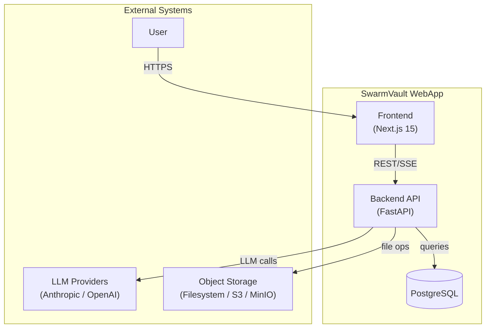
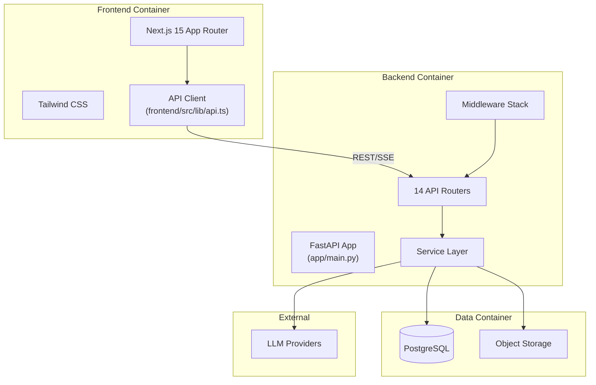
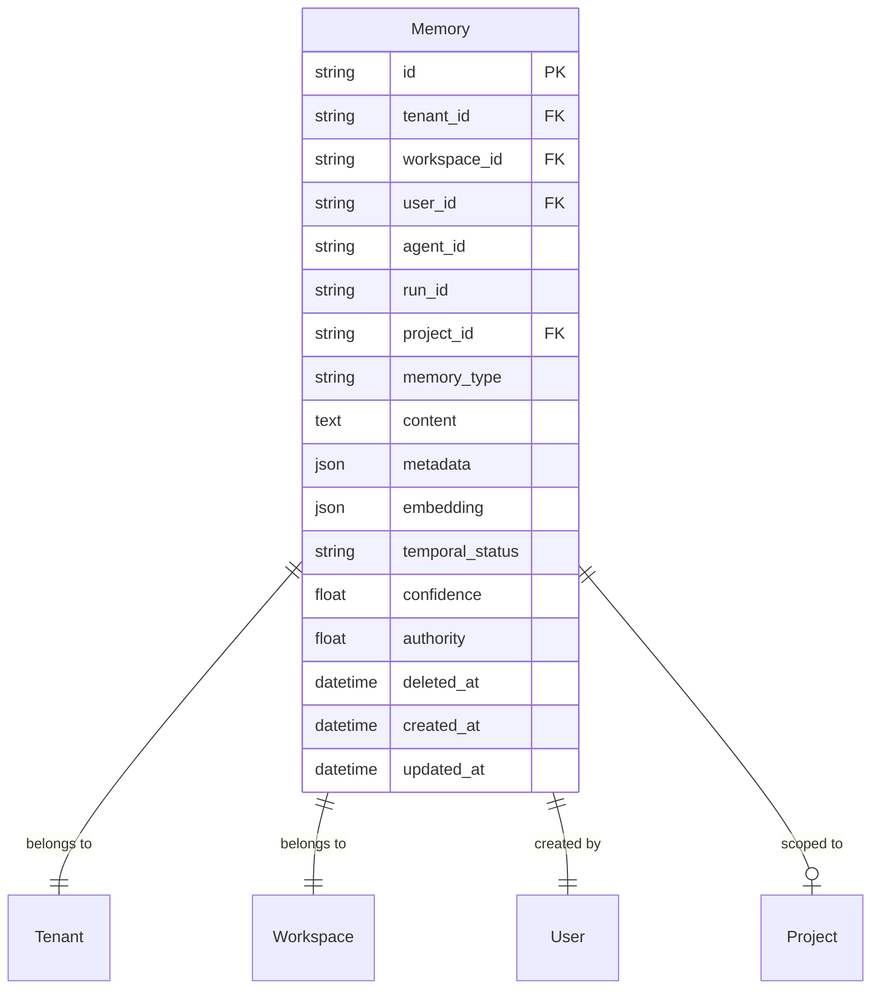
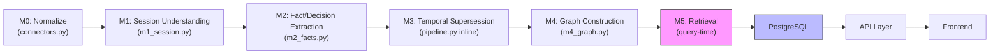

# SwarmVault Master Architecture

**Agent 4 Final Synthesis — Complete Enterprise Architecture**
Generated from source code forensics against `C:\Users\Administrator\Documents\SwarmVaultwebapp`
Classification: DOCUMENTATION ONLY — no product code was modified.

---

## 1. Executive Summary

SwarmVault WebApp is a **knowledge vault and memory intelligence platform** built with a FastAPI backend and Next.js frontend. It ingests conversations and documents, extracts structured knowledge (facts, decisions, graph relationships), and provides hybrid retrieval for grounded AI chat responses.

**Repository:** `C:\Users\Administrator\Documents\SwarmVaultwebapp`
**Backend:** FastAPI + SQLAlchemy 2.x + PostgreSQL (asyncpg)
**Frontend:** Next.js 15 (App Router) + React 18 + Tailwind CSS
**Test Command:** `pytest tests/` (backend), `npm test` (frontend)

**Certification Recommendation: ARCHITECTURE DOCUMENTATION CERTIFIED WITH LIMITATIONS**

The architecture is **functional and coherent** for its current scope. Key limitations exist in the memory intelligence layer (no LLM calibration, no vector search, incomplete supersession, missing contradiction detection). These are documented as P1/P2 gaps rather than architectural failures.

---

## 2. System Context



**What SwarmVault IS:**
- Conversation/document ingestion platform
- Knowledge extraction engine (facts, decisions, graph)
- Memory management system with temporal awareness
- Grounded AI chat with provenance tracking
- Workspace-based multi-tenant collaboration tool

**What SwarmVault IS NOT:**
- External agent integration (Claude Code, Codex, MCP) — **not implemented**
- Production-ready distributed deployment — single-process only
- Enterprise SSO — email/password + refresh tokens only

---

## 3. Architectural Principles

| Principle | Evidence | Classification |
|-----------|----------|----------------|
| **Repository-first** | Every claim traces to actual file:line citations | **IMPLEMENTED** |
| **Fail-closed** | PolicyEngine defaults to DENY (`app/services/policy/engine.py:37`) | **IMPLEMENTED** |
| **Tenancy isolation** | Every query filters by `workspace_id` from `TenantContext` | **IMPLEMENTED** |
| **Soft delete** | Most tables have `deleted_at`; no hard deletes for user data | **IMPLEMENTED** |
| **Append-only audit** | `audit_events` table — no UPDATE/DELETE from application | **IMPLEMENTED** |
| **Pipeline stage isolation** | M0-M5 are distinct functions with clear input/output contracts | **IMPLEMENTED** |
| **Policy-driven authorization** | PolicyEngine + RBAC evaluator for all sensitive operations | **IMPLEMENTED** |

---

## 4. High-Level Architecture (C4 Container)



---

## 5. Backend Architecture

### 5.1 Application Bootstrap (`app/main.py`)

```
lifespan startup:
  1. setup_logging() — only in development (main.py:167-168)
  2. init_db() — runs Alembic migrations (main.py:169, db.py:40-46)
  3. audit.register_db_sink() — wires DB persistence for audit events (main.py:171)
lifespan shutdown:
  — No cleanup (no LLM client close, no task drain) (main.py:172)
```

### 5.2 Middleware Stack (execution order, last-added = first-executed)

| Order | Middleware | File | Purpose |
|-------|-----------|------|---------|
| 1 | SecurityHeadersMiddleware | `app/main.py:47-81` | Security headers (CSP, HSTS, etc.) |
| 2 | RequestIdMiddleware | `app/main.py:21-44` | X-Request-ID + latency logging |
| 3 | AuditPersistenceMiddleware | `app/main.py:192-209` | Flush audit events to DB per request |
| 4 | CORSMiddleware | `app/main.py:216-223` | CORS handling |
| 5 | RateLimitMiddleware | `app/middleware/rate_limit.py:71-119` | Sliding window rate limiting |
| — | TenancyMiddleware | `app/middleware/tenancy.py:28-100` | Tenant/workspace resolution (dependency, not middleware) |
| — | AuthMiddleware | `app/middleware/auth.py:17-51` | JWT validation (dependency) |
| — | RBACMiddleware | `app/middleware/rbac.py` | Role enforcement (via require_min_role or require_policy) |

### 5.3 Router Inventory

| Prefix | File | Routes | Auth | RBAC |
|--------|------|--------|------|------|
| `/api/v1/auth` | `app/api/auth.py` | register, login, refresh, me | mixed | No |
| `/api/v1/workspace` | `app/api/workspace.py` | CRUD + members | Yes | Yes |
| `/api/v1/projects` | `app/api/projects.py` | CRUD | Yes | Yes |
| `/api/v1/sessions` | `app/api/sessions.py` | CRUD + history | Yes | Yes |
| `/api/v1/chat` | `app/api/chat.py` | stream, completions | Yes | Yes |
| `/api/v1/memory` | `app/api/memory.py` | CRUD + search + share + provenance + explain | Yes | Yes |
| `/api/v1/ingest` | `app/api/ingest.py` | upload, sources, facts, decisions, graph, timeline, search | Yes | Yes |
| `/api/v1/provenance` | `app/api/provenance.py` | session-level provenance | Yes | Yes |
| `/api/v1/dashboard` | `app/api/dashboard.py` | overview, memory-stats, activity | Yes | Yes |
| `/api/v1/feedback` | `app/api/feedback.py` | CRUD | Yes | Yes |
| `/api/v1/api-keys` | `app/api/api_keys.py` | CRUD + rotate | Yes | Yes |
| `/api/v1/storage` | `app/api/storage.py` | upload, download, delete | Yes | Yes |
| `/api/v1/policy` | `app/api/policy.py` | CRUD + versions | Yes | Yes (admin) |
| `/api/v1/audit` | `app/api/audit.py` | query | Yes | Yes (admin) |

### 5.4 Service Layer

| Service | File | Purpose |
|---------|------|---------|
| MemoryService | `app/services/memory.py` | Governed memory CRUD with policy + audit |
| Pipeline | `app/services/pipeline.py` | M0-M5 ingestion orchestration |
| ChatOrchestrator | `app/services/chat_orchestrator.py` | SSE chat with memory grounding |
| LLM | `app/services/llm.py` | Anthropic/OpenAI/Mock provider abstraction |
| Retrieval | `app/services/retrieval.py` | Memory keyword + vector search |
| M5 Retrieval | `app/services/m5_retrieval.py` | Fact/Decision multi-factor ranking |
| Connectors | `app/services/connectors.py` | Input normalization (7 connectors) |
| ObjectStorage | `app/services/object_storage.py` | Filesystem/S3/MinIO abstraction |
| PolicyEngine | `app/services/policy/engine.py` | Authorization evaluation |
| AuditService | `app/services/audit/service.py` | Audit event emission + buffering |

---

## 6. Frontend Architecture

### 6.1 Technology Stack
- **Framework:** Next.js 15 (App Router)
- **UI:** React 18 + Tailwind CSS 3.4
- **State:** React Context (AuthProvider, ThemeProvider) + localStorage
- **No global state library** (no Redux, Zustand, Jotai)

### 6.2 Route Structure

| Route | Client? | Purpose |
|-------|---------|---------|
| `/` | Yes | Redirect to dashboard |
| `/auth/login` | Yes | Login form |
| `/auth/register` | Yes | Registration form |
| `/dashboard` | Yes | Dashboard overview |
| `/projects` | Yes | Projects list |
| `/projects/[id]` layout | Yes | Project shell + sidebar |
| `/projects/[id]/chat` | Yes | Chat with SSE |
| `/projects/[id]/ingest` | Yes | Ingestion upload |
| `/projects/[id]/sessions` | Yes | Session list |
| `/projects/[id]/memory` | Yes | Memory CRUD |
| `/projects/[id]/facts` | Yes | Facts table |
| `/projects/[id]/decisions` | Yes | Decisions table |
| `/projects/[id]/timeline` | Yes | Timeline view |
| `/projects/[id]/search` | Yes | Hybrid search |
| `/projects/[id]/graph` | Yes | Graph visualization |
| `/projects/[id]/provenance` | Yes | Provenance explorer |
| `/projects/[id]/settings` | Yes | Project settings |
| `/settings` | Yes | User settings |
| `/settings/profile` | Yes | Profile edit |
| `/settings/api-keys` | Yes | API key management |
| `/settings/storage` | Yes | Storage config |

### 6.3 API Client (`frontend/src/lib/api.ts`)

- Token storage: `localStorage['sv_tokens']` = `{ access_token, refresh_token }`
- Auto-refresh on 401
- REST helpers: `apiGet`, `apiPost`, `apiPatch`, `apiDelete`
- SSE: `useSSE` hook with AbortController
- Upload: XMLHttpRequest with progress tracking

---

## 7. API Architecture

### 7.1 Versioning
- All routes under `/api/v1/`
- No deprecation policy — version bump required for breaking changes

### 7.2 Response Envelope

**Success:** Direct Pydantic model serialization
**Error:** `{"error": {"type": "...", "message": "...", "request_id": "..."}}`

### 7.3 SSE Streaming

- Endpoint: `POST /api/v1/chat/stream`
- Content-Type: `text/event-stream`
- Event format: `data: {JSON}` with `type: "token"|"done"|"error"`
- AbortController support in frontend

---

## 8. Data Architecture

### 8.1 Model Inventory (21 tables)

| Model | Table | Key Fields | Soft Delete |
|-------|-------|-----------|-------------|
| Tenant | `tenants` | id, name, slug, plan | No |
| Workspace | `workspaces` | id, tenant_id, name, slug | Yes (`deleted_at`) |
| User | `users` | id, email, hashed_password, is_active | Yes (`deleted_at`) |
| WorkspaceMember | `workspace_members` | id, workspace_id, user_id, role | No |
| Invitation | `invitations` | id, workspace_id, email, state | No |
| RefreshToken | `refresh_tokens` | id, user_id, token, expires_at, revoked | No (revoked flag) |
| Session | `sessions` | id, workspace_id, user_id, title, metadata | Yes (`deleted_at`) |
| Message | `messages` | id, session_id, role, content | No (cascade) |
| Project | `projects` | id, workspace_id, name | Yes (`deleted_at`) |
| Memory | `memories` | id, tenant_id, workspace_id, user_id, content, memory_type, confidence, authority | Yes (`deleted_at`) |
| IngestJob | `ingest_jobs` | id, project_id, workspace_id, source_type, status | No |
| Source | `sources` | id, project_id, workspace_id, source_type, content_hash, status | Yes (`deleted_at`) |
| NormalizedMessage | `normalized_messages` | id, source_id, session_id, role, content | No (cascade) |
| Fact | `facts` | id, workspace_id, subject, predicate, object, confidence, temporal_status | Yes (`deleted_at`) |
| Decision | `decisions` | id, workspace_id, content, confidence, temporal_status | Yes (`deleted_at`) |
| GraphNode | `graph_nodes` | id, workspace_id, label, node_type, temporal_status | Yes (`deleted_at`) |
| GraphEdge | `graph_edges` | id, workspace_id, source_node_id, target_node_id, relationship_type, confidence | Yes (`deleted_at`) |
| MessageProvenance | `message_provenance` | id, session_id, model, memory_ids_used, token counts | No (append-only) |
| MessageFeedback | `message_feedback` | id, workspace_id, user_id, rating | Yes (`deleted_at`) |
| ApiKey | `api_keys` | id, workspace_id, key_hash, key_prefix, expires_at, revoked_at | No (revoked flag) |
| Policy | `policies` | id, tenant_id, name, status | No (status field) |
| PolicyVersion | `policy_versions` | id, policy_id, version, rules | No (CASCADE) |
| AuditEvent | `audit_events` | id, event_type, result_status, principal_id, resource_type | No (append-only) |

### 8.2 Database Configuration (`app/db.py`)

```python
engine = create_async_engine(
    DATABASE_URL,
    pool_size=50,
    max_overflow=20,
    pool_pre_ping=True,
    pool_recycle=3600,
)
async_session_factory = async_sessionmaker(engine, class_=AsyncSession, expire_on_commit=False)
```

**Note:** `init_db()` runs `alembic upgrade head` via `loop.run_in_executor()` (`app/db.py:40-46`). Alembic IS used in production path, contrary to earlier forensics claims.

---

## 9. Memory Architecture

### 9.1 Memory Model



### 9.2 MemoryRecord vs Memory Model Gap

The `MemoryRecord` dataclass (`app/services/memory.py:62-119`) defines a richer model than the database schema. Fields lost during `_persist_record()`:

| MemoryRecord Field | Persisted? | Where |
|-------------------|-----------|-------|
| `scope` | **NO** | Stored in `extra_metadata["scope"]` — not queryable |
| `team_id` | **NO** | Completely lost |
| `valid_from` | **NO** | No column exists |
| `valid_until` | **NO** | No column exists |
| `expires_at` | **NO** | No column exists |
| `version` | **NO** | Stored in `extra_metadata` |
| `supersedes` | **NO** | Stored in `extra_metadata` |
| `superseded_by` | **NO** | Stored in `extra_metadata` |
| `provenance` | **NO** | Stored in `extra_metadata` — not queryable |
| `permissions` | **NO** | Stored in `extra_metadata` — not enforceable at DB level |
| `subject` | **PARTIAL** | `content = record.content or record.subject` — subject truncated to 100 chars on load |

### 9.3 Memory Type Taxonomy

| Source | Default Value |
|--------|--------------|
| `Memory` model | `"procedural_memory"` |
| `MemoryCreate` schema | `"procedural_memory"` |
| `MemoryRecord` dataclass | `"WORKING"` |
| `MemoryTypeMapper.CANONICAL_TO_VAULT` | `"PROCEDURAL"` → `"procedural"` |

**FINDING:** Four different representations of the same concept. The mapper produces `"procedural"` (no underscore), but the DB/schema default is `"procedural_memory"` (with underscore). These will never match in a type-filtered query.

---

## 10. Storage Architecture

### 10.1 Object Storage

Three backends configured via `settings.storage_backend`:
- **Filesystem** (default) — `./storage` directory
- **S3-compatible** — configured via `s3_endpoint`, `s3_access_key`, `s3_secret_key`
- **MinIO** — same config as S3

**Note:** The pipeline does NOT use object storage. Raw content is passed as a string in the HTTP request body. `Source.raw_content_path` is never populated by the current ingestion flow.

---

## 11. Security Architecture

### 11.1 Authentication
- JWT HS256 (`app/core/security.py`)
- Access token: 60 minutes (configurable)
- Refresh token: 30 days, DB-backed, rotatable
- Password hashing: bcrypt via passlib
- Token storage: `localStorage` (XSS-vulnerable)

### 11.2 Authorization — Two Paths

**Path 1: PolicyEngine (primary)**
- Used by `require_policy("resource", "action")` dependency
- Evaluates RBAC policies generated by `generate_rbac_policies()`
- Effects: ALLOW, DENY, CONFIRM, LIMITED, REDACTED
- **Note:** Policies are hardcoded, NOT loaded from DB `policies` table

**Path 2: require_min_role (secondary)**
- Numeric role comparison: owner > admin(500) > member(100) > viewer(50)
- Used by most route handlers

### 11.3 Tenancy
- `TenantContext` dataclass: `tenant_id`, `workspace_id`, `role`, `user_id`
- Resolved from JWT + optional `X-Workspace-Id` header
- Membership verified via `WorkspaceMember` table
- All data queries filter by `workspace_id`

### 11.4 Security Controls

| Control | Status | Location |
|---------|--------|----------|
| JWT authentication | **ACTIVE** | `app/middleware/auth.py` |
| Password hashing (bcrypt) | **ACTIVE** | `app/core/security.py` |
| Refresh token rotation | **ACTIVE** | `app/api/auth.py` |
| Rate limiting | **PARTIAL** | In-memory, not distributed-safe |
| CORS | **PARTIAL** | Wildcard default in dev; production must set `cors_origins_safe` |
| Security headers | **ACTIVE** | `app/main.py:47-81` |
| HSTS | **PRODUCTION ONLY** | `app/main.py:58-59` |
| CSP | **ACTIVE** | Production: `default-src 'self'`; Dev: permissive |
| Error sanitization | **PARTIAL** | `_sanitize_detail()` — no JWT/PII redaction |
| Audit logging | **PARTIAL** | Events defined, not all emitted |
| API key hashing | **ACTIVE** | SHA-256, prefix shown once |

---

## 12. Tenancy Architecture

```
Tenant (top-level organization)
  └── Workspace (contains members + projects)
        ├── WorkspaceMember (role: owner/admin/member/viewer)
        ├── Project
        ├── Session
        ├── Memory
        ├── Fact
        ├── Decision
        ├── GraphNode
        ├── GraphEdge
        └── Source
```

**Hierarchy:** Tenant → Workspace → Project
**Isolation:** Every query filters by `workspace_id` from `TenantContext`
**Role hierarchy:** owner > admin(500) > member(100) > viewer(50)

---

## 13. Pipeline Architecture (M0-M5)



### Stage Details

| Stage | Input | Output | Function |
|-------|-------|--------|----------|
| M0 | Raw content (string/dict) | NormalizedConversation | `connectors.normalize()` |
| M1 | NormalizedMessage list | SessionUnderstanding | `m1_session.understand_session()` |
| M2 | Messages + M1 context | Fact list + Decision list | `m2_facts.run_m2()` |
| M3 | Facts + Decisions | Updated temporal_status | Inline in `run_pipeline()` |
| M4 | Full conversation text | GraphNode list + GraphEdge list | `m4_graph.persist_graph()` |
| M5 | Query string + scope | RetrievalResult list | `m5_retrieval.retrieve_hybrid()` |

**Note:** M5 is query-time only — no indexing step. M1 output is NOT persisted.

---

## 14. Guardrail Architecture

### Guardrail Matrix

| Stage | Control | Enforcement | Status |
|-------|---------|------------|--------|
| HTTP Request | CORS | Middleware | **ACTIVE** |
| HTTP Request | Security Headers | Middleware | **ACTIVE** |
| HTTP Request | Rate Limiting | Middleware | **PARTIAL** — in-memory only |
| HTTP Request | Request ID | Middleware | **ACTIVE** |
| Auth | JWT decode | Dependency | **ACTIVE** |
| Auth | User active check | Dependency | **ACTIVE** |
| Tenancy | Workspace membership | Dependency | **ACTIVE** |
| Authorization | PolicyEngine | Dependency | **ACTIVE** — hardcoded policies |
| Body Validation | Pydantic schemas | Route handler | **ACTIVE** |
| Content Validation | Null bytes, length | Schema validators | **ACTIVE** |
| Source Validation | source_type pattern | Schema | **ACTIVE** |
| Dedup | Content hash | DB unique constraint | **ACTIVE** |
| Project Scope | Workspace membership check | Route handler | **ACTIVE** |
| Soft Delete | deleted_at filtering | Service layer | **PARTIAL** — inconsistent across endpoints |
| Error Sanitization | _sanitize_detail | Exception handler | **PARTIAL** — no JWT/PII redaction |

---

## 15. Provenance Architecture

### What Is Tracked
- **MessageProvenance** — every chat response: model, provider, memory_ids_used, token counts, latency, confidence
- **AuditEvent** — append-only event log for policy decisions, memory operations, auth events
- **Source** — ingestion source with content_hash for dedup

### What Is NOT Tracked
- Memory provenance chain (stored in JSON only, not linked to MessageProvenance)
- System prompt version or hash
- Model parameters (temperature, max_tokens)
- Tool call chains
- Pipeline stage transitions (only M0 start/completion audited)

---

## 16. Retrieval Architecture

### M5 Multi-Factor Scoring

| Factor | Weight (Fact) | Weight (Decision) | Implementation |
|--------|--------------|-------------------|----------------|
| Keyword (BM25) | 0.25 | 0.25 | `_bm25_score()` |
| Recency | 0.15 | 0.15 | Exponential decay, 30-day half-life |
| Authority | 0.15 | 0.15 | DB column value |
| Confidence | 0.15 | 0.15 | DB column value |
| Temporal status | 0.20 | 0.30 | current=1.0, historical=0.3 |
| Graph connectivity | 0.10 | — | Log-scaled edge count |

### Memory Retrieval (`retrieval.py`)
- Keyword overlap score
- Optional embedding cosine similarity (never used — no embeddings)
- Falls back to keyword-only when no embedding present

---

## 17. SSE/Streaming Architecture

- **Endpoint:** `POST /api/v1/chat/stream`
- **Format:** `text/event-stream`
- **Events:** `token` (text chunks), `done` (completion), `error` (failures)
- **No timeout** on SSE response — slow client holds connection open
- **Client disconnection** handled via FastAPI's built-in `CancelledError` — LLM call continues until completion

---

## 18. Ingestion Architecture

```
HTTP POST /api/v1/ingest/upload
  → Project scope check
  → Content hash dedup check
  → Pipeline: M0 → M1 → M2 → M3 → M4
  → Source + Session + NormalizedMessages + Facts + Decisions + GraphNodes + GraphEdges
```

**Connectors:** text, json, jsonl, chatgpt (7 total via `BaseConnector` registry)
**Dedup:** SHA-256 content hash with unique constraint per workspace
**Volume limits:** 10MB content, 100KB per message, 10,000 messages per source

---

## 19. Integration Architecture

| Integration | Classification | Evidence |
|------------|---------------|----------|
| Anthropic LLM | **IMPLEMENTED** | `app/services/llm.py:43-92` |
| OpenAI LLM | **IMPLEMENTED** | `app/services/llm.py:95-130` |
| Mock LLM | **IMPLEMENTED** | Fallback when no API key |
| Filesystem Storage | **IMPLEMENTED** | `app/services/object_storage.py` |
| S3 Storage | **IMPLEMENTED** | Configured via settings |
| MinIO Storage | **IMPLEMENTED** | Same config as S3 |
| Claude Code Integration | **NOT IMPLEMENTED** | No code found |
| Codex Integration | **NOT IMPLEMENTED** | No code found |
| MCP Server | **NOT IMPLEMENTED** | ApiKey model exists but no MCP server |

---

## 20. Deployment Architecture

### Docker
- Multi-stage build: `python:3.12-slim` → `swarmvault` user
- Exposes port 8000
- Entrypoint: `alembic upgrade head && uvicorn app.main:app`

### docker-compose
- Services: postgres:16-alpine, app
- Volumes: postgres_data, app_storage, app_logs
- No health check defined for app service (health endpoints exist in code)

### Environment
- `app/core/config.py` — pydantic-settings with `.env` support
- Production guards: `SECRET_KEY` validation, `cors_origins_safe`, `is_production` flags

---

## 21. Failure & Recovery Architecture

| Failure Point | Recovery Mechanism | Gap |
|---------------|-------------------|-----|
| LLM call failure | Timeout + retry with exponential backoff | No circuit breaker |
| Database connection | `pool_pre_ping=True`, `pool_recycle=3600` | No connection recovery logging |
| Pipeline failure | Source marked `status="failed"`, `error_message` set | Partial output preserved (Source + Session created) |
| Audit DB sink failure | Logged as warning, never blocks response | No retry or dead-letter queue |
| SSE client disconnect | FastAPI `CancelledError` | LLM call continues (wastes tokens) |
| Rate limit breach | 429 response with `Retry-After` header | In-memory limiter not distributed-safe |

---

## 22. Observability Architecture

| Aspect | Status | Implementation |
|--------|--------|---------------|
| Structured logging | **ACTIVE** | JSON format via `StructuredFormatter` (development only) |
| Request ID | **ACTIVE** | `X-Request-ID` middleware |
| Latency logging | **ACTIVE** | RequestIdMiddleware logs latency_ms |
| Metrics endpoint | **MISSING** | `enable_metrics=False` by default, no endpoint |
| Distributed tracing | **MISSING** | No OpenTelemetry, Jaeger, or X-Ray |
| Health endpoints | **ACTIVE** | `/health`, `/health/live`, `/health/ready` |
| Readiness probe | **ACTIVE** | Checks DB connection via `SELECT 1` |

---

## 23. Test Architecture

### Test Framework
- **Backend:** pytest + pytest-asyncio
- **Frontend:** npm test (Jest/Vitest — not inspected in this session)

### Test Coverage Evidence
- Security tests: `tests/unit/test_security_6b.py`
- RBAC tests: `tests/unit/test_rbac_security.py`
- Tenancy tests: `tests/unit/test_tenancy.py`
- Rate limit tests: `tests/unit/test_rate_limit.py`
- Connector security: `tests/unit/test_connector_security.py`
- Storage security: `tests/unit/test_storage_security.py`
- Policy engine tests: `tests/unit/test_policy_engine.py`
- Authorization audit: `tests/unit/test_authorization_audit.py`

**Gap:** No test coverage for M1-M5 pipeline stages individually. No test for Memory CRUD with policy engine. No test for cross-tenant memory access.

---

## 24. Current Limitations

| # | Limitation | Severity | Evidence |
|---|-----------|----------|----------|
| L1 | No LLM calibration of confidence/authority | **P1** | `app/services/pipeline.py:129-130` — hardcoded values |
| L2 | Vector search non-functional | **P1** | `app/models.py:253` — embedding column never populated |
| L3 | Superseded_by_id never written | **P1** | `app/services/pipeline.py:117` — only temporal_status updated |
| L4 | Memory type taxonomy inconsistent | **P2** | 4 different defaults across DB/schema/record/mapper |
| L5 | No contradiction detection | **P2** | No code for detecting conflicting facts |
| L6 | Memory provenance in JSON only | **P2** | `app/services/memory.py:229-241` — not queryable |
| L7 | No memory expiry mechanism | **P2** | No `expires_at` column, no scheduled cleanup |
| L8 | Pipeline runs synchronously | **P2** | `app/api/ingest.py:81-91` — awaited directly |
| L9 | In-memory rate limiter | **P2** | `app/middleware/rate_limit.py` — single-process only |
| L10 | No API key expiry enforcement | **P2** | `app/api/api_keys.py` — expiry tracked but not checked |

---

## 25. Technical Debt

| # | Debt | Severity | Evidence |
|---|------|----------|----------|
| D1 | `_PERMISSIONS` dict in rbac.py is dead code | **Low** | `app/middleware/rbac.py:34-70` — never used by routes |
| D2 | `m3_temporal.supersede_fact()` and `supersede_decision()` unused | **Low** | Pipeline uses inline logic instead |
| D3 | PolicyEngine evaluates hardcoded policies, not DB policies | **Medium** | `app/services/policy/evaluator.py:76-100` |
| D4 | `extra_metadata` JSON used as catch-all for Memory | **Medium** | `app/services/memory.py:229-241` |
| D5 | AuditEvent DTO/ORM field name mismatch | **Low** | `service.py:97` uses `metadata`, ORM uses `event_metadata` |
| D6 | No graceful shutdown cleanup | **Low** | `app/main.py:172` — empty yield |
| D7 | MemoryService singleton pattern with global | **Low** | `app/api/memory.py:33-43` |

---

## 26. Future Memory Intelligence Boundary

### What Is Ready for Intelligence Layer

| Capability | Readiness | Notes |
|------------|-----------|-------|
| Fact/Decision retrieval | **READY** | Multi-factor scoring, temporal awareness |
| Graph topology | **READY** | Deduplicated nodes/edges with relationships |
| Provenance for chat | **READY** | Complete MessageProvenance chains |
| Memory content | **CONDITIONALLY READY** | Content is persisted, but confidence/authority are defaults |
| Session understanding | **NOT READY** | M1 output not persisted |

### What Must Be Built First

1. **Provenance contract for Memory** — every memory must have a source chain
2. **Authority calibration** — confidence/authority must be set by extraction, not defaults
3. **Supersession linkage** — `superseded_by_id` must be written and linked to Memory
4. **Contradiction detection** — conflicting facts/decisions must be detectable
5. **Vector embeddings** — embedding generation + pgvector for semantic search
6. **Memory expiry** — `expires_at` column + lifecycle management
7. **Unified type taxonomy** — single source of truth for memory types

---

## 27. Architectural Readiness Assessment

| Capability | Grade | Evidence |
|------------|-------|----------|
| Authentication | **A** | JWT HS256, bcrypt, refresh tokens |
| Authorization | **B+** | PolicyEngine + RBAC, but hardcoded policies |
| Tenancy Isolation | **A** | Every query filters by workspace_id |
| Data Persistence | **A** | 21 tables, soft delete, indexes |
| Memory Model | **B** | Functional but with data loss in persistence |
| Pipeline (M0-M4) | **B+** | Functional extraction with regex limitations |
| Retrieval (M5) | **B** | Multi-factor scoring, but vector search broken |
| Provenance | **B** | Chat provenance complete, memory provenance partial |
| Audit | **B** | Infrastructure complete, coverage partial |
| API Design | **B+** | Consistent routes, SSE streaming, but no versioning policy |
| Frontend | **B+** | Clean Next.js structure, consistent API client |
| Security Headers | **A** | Comprehensive CSP, HSTS, XSS protection |
| Rate Limiting | **C+** | Functional but in-memory only |
| Observability | **C** | Logging only, no metrics or tracing |
| Error Handling | **B** | Sanitized errors, but no JWT/PII redaction |
| Deployment | **C+** | Docker works, but single-process only |
| Test Coverage | **C** | Security tests exist, pipeline tests missing |

**Overall: CERTIFIED WITH LIMITATIONS (B grade)**

The architecture is sound for its current scope as a knowledge vault and memory platform. The primary limitations are in the memory intelligence layer: no LLM calibration, no functional vector search, incomplete supersession, and missing contradiction detection. These are P1/P2 gaps that can be addressed incrementally without architectural redesign.

---

*End of Document B: SWARMVAULT_MASTER_ARCHITECTURE.md*
